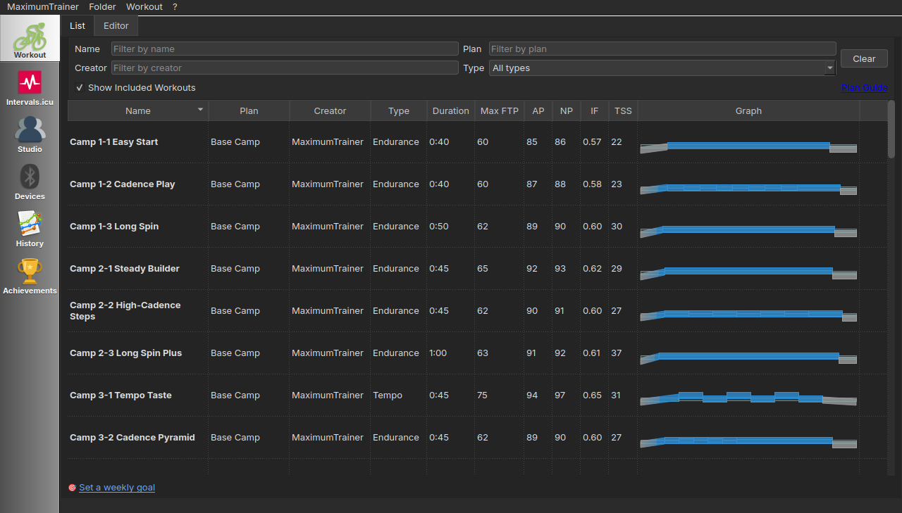
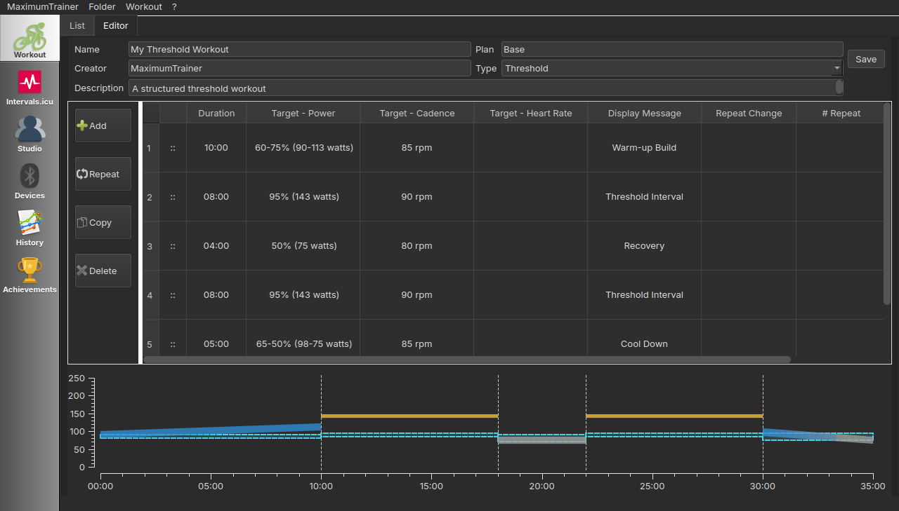
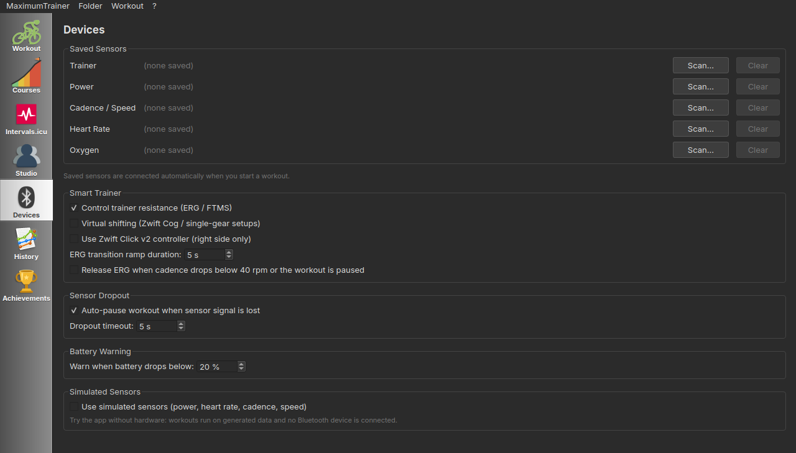
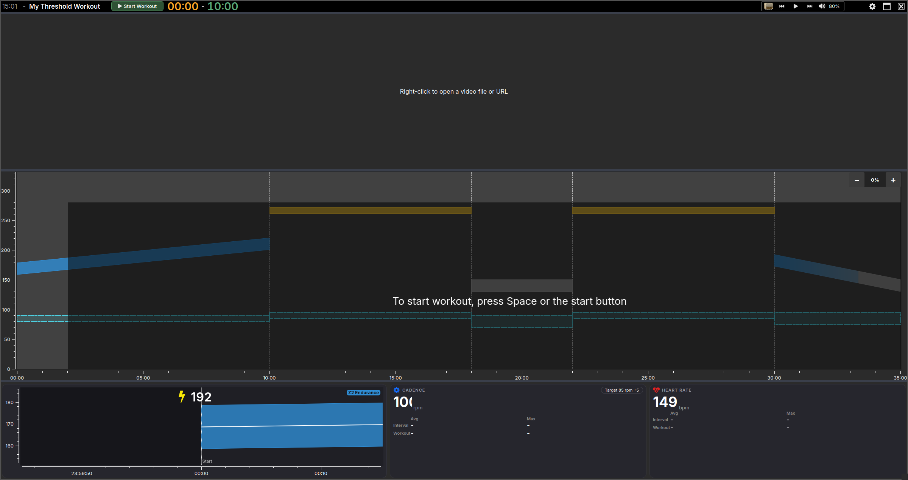
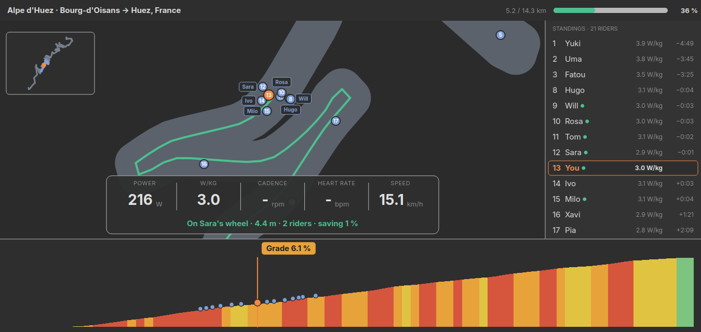
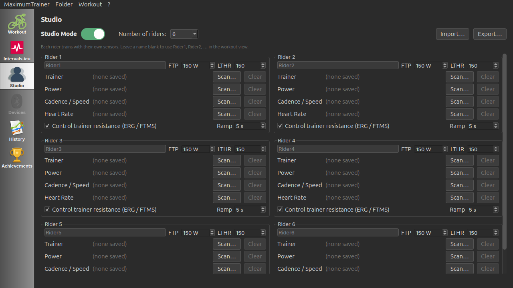

# MaximumTrainer

An open-source, high-performance indoor cycling training application built with the **Qt framework (C++20)**. MaximumTrainer delivers structured interval workouts with real-time power, cadence, heart rate, and speed feedback, and controls smart trainers automatically via FTMS ERG mode. Browse and sync workouts from [intervals.icu](https://www.intervals.icu), or import your own `.erg` / `.mrc` / `.zwo` files. Ride the same workout with friends over the internet with **group workouts**: no account or subscription needed.

> 📖 **Want to use the app?** See the **[User Guide](https://maximumtrainer.github.io/MaximumTrainer_Redux/user-guide.html)** — pairing sensors, finding & building workouts, training, group workouts, Studio mode, and more.

## Download

Prebuilt binaries for each release live on the [**Releases**](https://github.com/MaximumTrainer/MaximumTrainer_Redux/releases) page — you don't need to build from source unless you want to. Grab the asset for your platform from the latest release:

| Platform | Asset | Notes |
|----------|-------|-------|
| **Linux** | `MaximumTrainer-linux-x86_64.AppImage` | Ubuntu 22.04+ or equivalent. `chmod +x` it and run - self-contained, no install |
| **Windows** | `MaximumTrainer-windows-x64.msi` (installer) or `-windows-x64.zip` (portable) | Windows 10 1809+. The Visual C++ runtime is bundled, no redistributable needed |
| **macOS** | `MaximumTrainer-macos.dmg` | macOS 13+, Apple Silicon. Open and drag to Applications |
| **Web (WASM)** | `MaximumTrainer-wasm.zip` | Chrome or Edge (needs Web Bluetooth) |

### System requirements

- **Windows:** Windows 10 version 1809 or later (the minimum for Qt 6.11); Windows 7, 8 and 8.1
  are not supported. A Bluetooth 4.0+ adapter with a WDM-compatible driver; no special
  permissions are needed.
- **All platforms:** Bluetooth LE for sensors and trainers. See the User Guide's
  [Platform Requirements](https://maximumtrainer.github.io/MaximumTrainer_Redux/user-guide.html#platform-requirements).

### First launch

The release builds are not code-signed, so each OS warns the first time you open them:

- **Windows:** SmartScreen shows *"Windows protected your PC"*. Click **More info → Run anyway**.
  On Windows **N editions**, install the **Media Feature Pack** (Settings → Apps → Optional features)
  or audio and video won't play.
- **macOS:** Gatekeeper refuses to open the app. Go to **System Settings → Privacy & Security**,
  click **Open Anyway** next to the MaximumTrainer message, then confirm. Alternatively, run:
  `xattr -dr com.apple.quarantine /Applications/MaximumTrainer.app`
- **Linux:** AppImages need FUSE 2. If the app doesn't start, install it
  (`sudo apt install libfuse2t64` on Ubuntu 24.04+, `libfuse2` on 22.04), or run
  `./MaximumTrainer-linux-x86_64.AppImage --appimage-extract-and-run`.

Prefer to compile it yourself? See [Building](#building) below.

## Technical Overview

| Item | Details |
|------|---------|
| **Language** | C++20 (≈ 95 % C++) |
| **Framework** | Qt 6 (6.11+) on all platforms |
| **Build system** | CMake 3.25+ (`CMakeLists.txt`), Ninja recommended |
| **Qt modules** | core · gui · widgets · network · websockets · bluetooth · webenginewidgets · printsupport · concurrent · multimedia |
| **Trainer protocol** | Bluetooth LE Fitness Machine Service (FTMS / 0x1826) for ERG resistance control |
| **Sensor profiles** | Heart Rate (0x180D) · Cycling Speed & Cadence (0x1816) · Cycling Power (0x1818) · Moxy Muscle Oxygen (0xAAB0) |
| **Workout formats** | `.erg`, `.mrc`, `.zwo` (imported and converted to the native XML format) · Intervals.icu calendar sync · export as `.fit` |
| **Workout source** | Integrated intervals.icu for online workout plans |
| **Group workouts** | Small relay on Cloudflare Workers (`workers/group-relay/`) passes room messages over WebSockets; trainer control stays local |

## Using MaximumTrainer

For everything about **using** the app — pairing sensors, finding / importing / creating workouts, ERG vs Slope, the workout player (video · web), group workouts, Studio mode, activity uploads, and troubleshooting — see the **[User Guide](https://maximumtrainer.github.io/MaximumTrainer_Redux/user-guide.html)**.

> **No hardware?** Turn on **Devices → Simulated Sensors**: the simulator emits realistic drifting
> power / HR / cadence / speed and responds to ERG commands, so you can exercise the full workout flow — handy for
> development and CI — without any Bluetooth devices.

## Screenshots

| Workout library |
|-----------------|
|  |

| Workout editor |
|----------------|
|  |

| Devices — pairing & trainer config |
|------------------------------------|
|  |

| Workout in progress |
|---------------------|
|  |

| Courses (Beta) - ride Alpe d'Huez, Mont Ventoux, Central Park or Longchamp against bots |
|---------------------------------------------------------------------------|
|  |

| Studio mode — per-rider configuration |
|---------------------------------------|
|  |

## Building

All three platforms are built and tested automatically via GitHub Actions CI (see `.github/workflows/build.yml`). The build uses CMake (3.25+) with Ninja and a C++20 compiler. Point it at QWT with `-DQWT_INSTALL=...`; the app lands in `build/release/` and the test suites in `build/tests/`.

| CMake option | Default | Purpose |
|--------------|---------|---------|
| `QWT_INSTALL` | (empty) | QWT 6.3 install prefix |
| `MT_BUILD_TESTS` | `ON` | Build the Qt Test suites |
| `MT_BUILD_APP` | `ON` | `OFF` builds only the test suites (no QWT or WebEngine needed) |
| `MT_WERROR` | `OFF` | Warnings as errors (CI) |
| `MT_SANITIZE` | (empty) | e.g. `address;undefined` |

### Dependencies

| Dependency | Version | Platform | Notes |
|------------|---------|----------|-------|
| Qt | 6.x (6.11+) | all | Core framework (incl. QtMultimedia, QtWebEngine, QtBluetooth, QtWebSockets) |
| QWT | 6.3.0 | all | Plotting widgets (built from source against Qt 6) |

> **Audio & media playback:** both sound-effect feedback (interval beeps, etc.,
> via `QSoundEffect`) and the embedded video + internet-radio player
> (`QMediaPlayer` / `QVideoWidget` / `QAudioOutput`) use Qt's own
> **QtMultimedia**.

### Windows

**Required tools:** Qt 6.x (msvc2022_64, with the `qtwebengine`, `qtconnectivity`,
`qtmultimedia`, `qtwebchannel`, `qtpositioning`, `qtwebsockets` modules), Visual Studio 2022+ (MSVC; Qt 6.11 ships msvc2022 builds only).

From a "x64 Native Tools" (MSVC) prompt, with Qt's `bin` on `PATH`:

```powershell
cmake -S . -B build -G Ninja -DCMAKE_PREFIX_PATH=C:/Qt/6.11.3/msvc2022_64 -DQWT_INSTALL=C:/qwt
cmake --build build
```

> The Windows Kit libraries (`Gdi32`, `User32`) are resolved automatically by the MSVC linker.

**Download links:**
- Qt 6.x: https://www.qt.io/download
- QWT 6.3.0: https://sourceforge.net/projects/qwt/files/qwt/6.3.0/

### Linux

Install Qt 6 + dependencies, build QWT 6 from source (no Qt6 `qwt` apt package
exists), then build the app:

```bash
sudo apt-get install -y \
  qt6-base-dev qt6-webengine-dev qt6-connectivity-dev \
  qt6-multimedia-dev qt6-webchannel-dev qt6-positioning-dev \
  qt6-websockets-dev qt6-declarative-dev cmake ninja-build build-essential

# Build QWT 6.3.0 from source against Qt 6 (installs to /tmp/qwt6 here)
cd /tmp && curl -L -o qwt.tar.bz2 \
  "https://sourceforge.net/projects/qwt/files/qwt/6.3.0/qwt-6.3.0.tar.bz2/download"
tar xf qwt.tar.bz2 && cd qwt-6.3.0
qmake6 qwt.pro && make -j$(nproc)
make install INSTALL_ROOT=/tmp/qwt6-stage
mkdir -p /tmp/qwt6 && mv /tmp/qwt6-stage/usr/local/qwt-6.3.0/* /tmp/qwt6/

# Build MaximumTrainer (and the test suites)
cd /path/to/MaximumTrainer_Redux
cmake -S . -B build -G Ninja -DQWT_INSTALL=/tmp/qwt6
cmake --build build
# Run the tests
ctest --test-dir build -j$(nproc)
# Run (QWT in a non-standard prefix needs LD_LIBRARY_PATH):
LD_LIBRARY_PATH=/tmp/qwt6/lib ./build/release/MaximumTrainer
```

> **Wayland:** QtWebEngine and some embedded native widgets are more stable under
> XWayland than the native Wayland QPA plugin, so on a Wayland session the app
> forces the `xcb` platform automatically. Set `QT_QPA_PLATFORM` yourself to override.

### macOS

Uses Qt 6.11.3 with Clang. QWT is built from source (non-framework) against Qt 6.

> **macOS Bluetooth permission:** The app's `mac/Info.plist` includes the `NSBluetoothAlwaysUsageDescription` key, which is required by macOS 10.15+ for any app that accesses BLE devices. The first time the app attempts to connect a sensor, macOS will prompt for Bluetooth permission. This permission can be reviewed or revoked in **System Settings → Privacy & Security → Bluetooth**.

```bash
# Install Qt 6.11.3 (with the qtwebsockets module) via install-qt-action or the Qt Installer, then:

# Build QWT 6.3.0 from source (non-framework, required for Qt 6)
curl -L -o /tmp/qwt.tar.bz2 "https://sourceforge.net/projects/qwt/files/qwt/6.3.0/qwt-6.3.0.tar.bz2/download"
tar -xjf /tmp/qwt.tar.bz2 -C /tmp && cd /tmp/qwt-6.3.0
sed -i.bak 's/QwtFramework//' qwtconfig.pri
qmake qwt.pro && make -j$(sysctl -n hw.logicalcpu) && sudo make install

# Build MaximumTrainer
cd /path/to/MaximumTrainer_Redux
cmake -S . -B build -G Ninja -DCMAKE_PREFIX_PATH="$QT_ROOT_DIR" -DQWT_INSTALL=/usr/local/qwt-6.3.0
cmake --build build
```

## Testing

MaximumTrainer has a multi-tier test suite covering BLE parsing, service APIs, UI flows, and integration scenarios — all run headlessly in CI without real hardware.

### Test tiers

| Suite | Location | What is tested |
|-------|----------|----------------|
| BLE unit tests | `tests/btle/` | BLE characteristic parsing (HR, CSC, Power, FTMS), SimulatorHub signal emission, trainer simulations (Elite, Wahoo KICKR, Garmin Tacx), battery level, interval summary |
| Service unit tests | `tests/strava/`, `tests/intervals_icu/` | HTTP request construction, auth headers, URL patterns, null-manager guards for the Strava and Intervals.icu upload services |
| ZWO importer tests | `tests/intervals_icu/` | Parsing of SteadyState, Ramp, IntervalsT, FreeRide, mixed, and malformed ZWO workout files |
| Credential store tests | `tests/credential_store/` | Round-trip read/write, overwrite, remove, missing key, multi-service, WASM no-op |
| Config bootstrap tests | `tests/config_bootstrap/` | First-run default configuration, legacy settings migration, unreadable settings store, credential load failures logged without values |
| Logger tests | `tests/logger/` | Log level filtering, output format, file write enable/disable |
| Studio tests | `tests/studio/` | Multi-hub simultaneous signals, user-ID propagation, FTP scaling |
| Workout export tests | `tests/workout_export/` | FIT workout steps (ramps, % FTP, cadence, intensity), file decodes as a FIT workout |
| Course race tests | `tests/race/` | Bundled courses, lap wrapping, grades and next climb, speed from power/weight/grade, drafting, bots, standings; a 3 W/kg rider can stay with the 3 W/kg pace bots |
| Group workout tests | `tests/group/` | Room-code parsing, message encode/decode, clock-offset estimate, rider-row states, group-ride start and telemetry; live relay test when `GROUP_RELAY_URL` is set |
| Workout logic tests | `tests/workout/` | Per-second sensor averaging per rider, MAP ramp-test failure rules and result formula |
| Achievement tests | `tests/achievements/` | Achievement list (unique keys, categories), history stats (totals, streaks, 7-day windows, time of day), unlock rules, live peak-effort tracker (sprints, FTP efforts, cadence) and local storage |
| Login screen tests | `tests/integration/` | OAuth dialog state, offline login path, Intervals.icu OAuth URL generation |
| Workout UI tests | `tests/integration/` | Full ERG session driven by SimulatorHub through WorkoutDialog; interval advancement; data accumulation |
| Offline / BLE integration | `tests/integration/` | BLE adapter smoke test, offline mode screenshot, runtime validation |
| Playwright (E2E) | `tests/playwright/` | WASM asset loading, Web Bluetooth API mock, login screen, landing page |

### Sanitizers and static analysis

`sanitizers.yml` runs the headless suites (`.github/sanitizer-suites.txt`) under
AddressSanitizer + UndefinedBehaviorSanitizer, gates on clang-tidy and measures
coverage.

### Running the BLE unit tests

```bash
cmake --build build --target btle_tests
./build/tests/btle_tests -v2
```

Every suite is a CMake target of the same name; `ctest --test-dir build -R btle` runs it through CTest.

The BLE suite has **51 test cases** across HR parsing, CSC, Power, FTMS, trainer simulations, SimulatorHub, battery, and interval summary. See the [CI run status](https://github.com/MaximumTrainer/MaximumTrainer_Redux/actions) for pass/fail counts on Linux, Windows, and macOS.

### Group workout relay

The group-workout relay is a Cloudflare Worker with one Durable Object per room
(`workers/group-relay/`, deployed by `deploy-group-relay.yml`). To develop
against a local copy and simulate riders:

```bash
cd workers/group-relay && npx wrangler dev --port 8787     # local relay, no account needed
node test/relay.smoke.mjs                                   # relay smoke test
MT_GROUP_RELAY_URL=ws://127.0.0.1:8787 LD_LIBRARY_PATH=/tmp/qwt6/lib ./build/release/MaximumTrainer
LD_LIBRARY_PATH=/tmp/qwt6/lib ./build/release/MaximumTrainer --group-sim 20 30   # 20 simulated riders
```

`--group-sim 19 600 --join XXXX --relay <url>` adds 19 simulated riders to a
room hosted in the app, to check the riders column with a full room.

## Log Files

MaximumTrainer writes a diagnostic log (network errors, BLE events, OAuth login steps), enabled by
default. Where to find it, how it rotates, what a crash writes and what to attach to a bug report
are covered in the
[User Guide - Log Files & Troubleshooting](https://maximumtrainer.github.io/MaximumTrainer_Redux/user-guide.html#log-files).
Launch with `--debug` (or `/debug` on Windows) for Debug-level detail from the first line.

## Credits

The bundled **Polarized 3x** training plan is adapted from
[Robin Ingelbrecht's zwift-workouts](https://github.com/robiningelbrecht/zwift-workouts)
(MIT license).

## TODO

Project now going through new revisions, with plans to enhance as an open-source interval trainer for indoor cycling & indoor rowing.
backlog and work items can be found [here](https://github.com/users/MaximumTrainer/projects/2/views/1)
